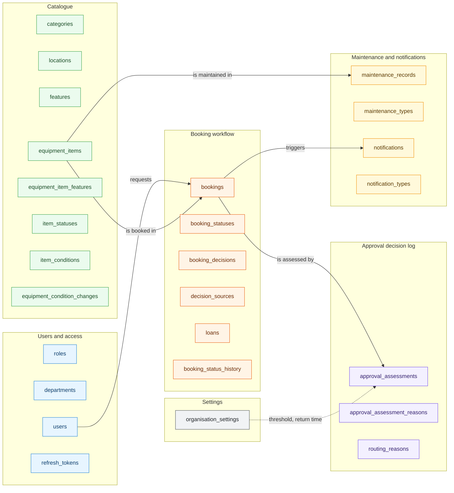
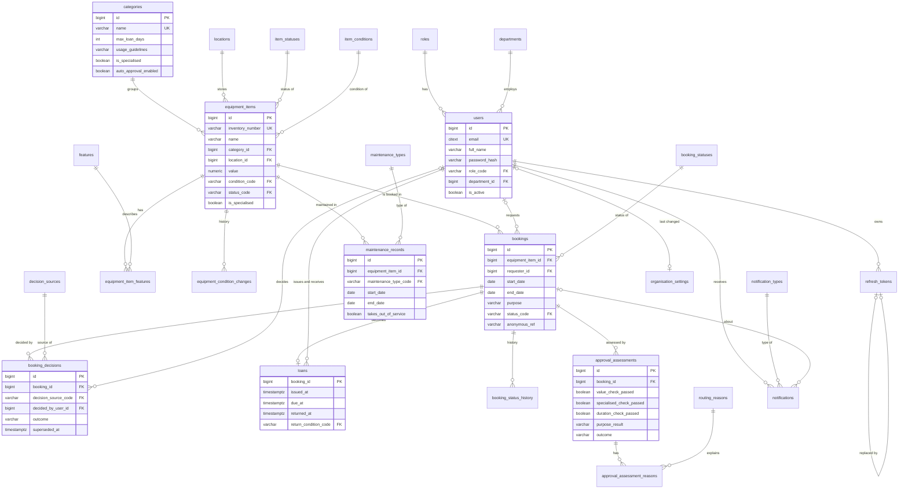

# Logical schema

The schema `app` has 26 tables in six blocks. The first diagram shows the blocks and how they relate; the second shows every table with its keys and relationships. Both diagrams are Mermaid sources and render on GitHub.

## Blocks

| Block | Colour | Purpose |
|---|---|---|
| Users and access | blue | People, roles, departments and refresh tokens |
| Catalogue | green | Items, categories, locations, searchable features and condition history |
| Booking workflow | orange | Requests, decisions, loans and the status history |
| Approval decision log | violet | Result of every policy check and the purpose check, with all reasons for routing |
| Maintenance and notifications | yellow | Maintenance records and in-app notifications (outbox for e-mail) |
| Settings | grey | Organisation wide threshold, automatic approval switch, retention and return time |

## Entity relationship diagram

Column level details of every table are in [data-dictionary.md](data-dictionary.md).
