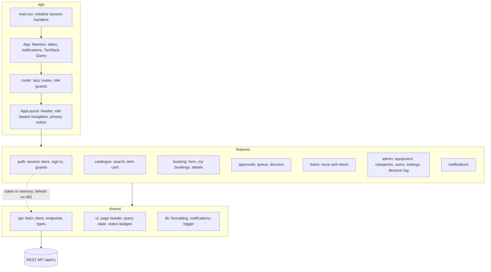
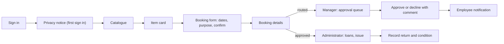

# Frontend

Single page application built with React 19, TypeScript and Vite. It talks only to the REST API under `/api/v1`.

## Architecture



| Layer | Content |
|---|---|
| `app` | Providers, router with lazy loaded pages, layout and navigation by role |
| `features` | One folder per business area with its pages, forms and hooks |
| `pages` | Pages without business logic (errors, privacy notice) |
| `shared/api` | Typed `fetch` client, endpoint functions and API types |
| `shared/ui`, `shared/lib` | Reusable components and helpers |

## Approach

- Component based architecture with a feature based folder structure; pages compose feature components, components never call `fetch` directly.
- Server state with TanStack Query (caching, loading and error states, invalidation after mutations); global client state with Zustand (session: user and access token); local state with React state and react-hook-form.
- Forms use react-hook-form with zod schemas; server validation errors (`errors` in problem details) are shown next to the fields.
- Every route except sign in is protected by `RequireAuth`; administrator and manager pages also by `RequireRole`. Pages are code split with lazy routes.
- Errors: the router error boundary shows the 404, 403 and 500 pages; failed queries show an alert with retry; failed mutations show a toast; `401` triggers one token refresh and then sign out.
- Loading: skeletons for every list and detail.
- Responsive: Mantine grid and AppShell; the navigation collapses into a burger menu and the catalogue switches from a table to cards on small screens.
- Accessibility: semantic Mantine components, labelled controls and icon buttons, visible focus outline, colour is never the only carrier of information.

## API usage

The client (`src/shared/api/httpClient.ts`) adds `Authorization: Bearer <token>`, sends JSON, normalises errors to `ApiError` with the problem details `code`, and refreshes the session once on `401`. The access token lives only in memory; the refresh token is an HttpOnly cookie that scripts cannot read. In development Vite proxies `/api` to `http://localhost:5186`, so the SPA and the API share one origin.

```ts
// Search the catalogue for items free on given dates
const page = await catalogueApi.search({ q: 'camera', availableFrom: '2026-11-20', availableTo: '2026-11-22', page: 1 })

// Request an item; a 409 with code "booking.overlap" lists the conflicting periods
const booking = await bookingsApi.create({ equipmentItemId: 46, startDate: '2026-11-20', endDate: '2026-11-22', purpose: 'Client interview' })
```

| Area | Endpoints |
|---|---|
| Session | `POST /auth/sessions`, `POST /auth/sessions/refresh`, `DELETE /auth/sessions/current`, `GET /me` |
| Catalogue | `GET /equipment`, `GET /equipment/{id}`, `GET /equipment/{id}/booked-periods` |
| Bookings | `POST /bookings`, `GET /me/bookings`, `GET /bookings/{id}`, `PATCH /bookings/{id}`, `POST /bookings/{id}/cancellation` |
| Manager | `GET /approval-queue`, `POST /bookings/{id}/decisions`, `GET /bookings/{id}/requester-history` |
| Administrator | `GET /loans`, `POST /bookings/{id}/loan`, `PUT /bookings/{id}/loan/return`, equipment, categories, users, settings, maintenance records, decision log |

The full specification is `docs/api/openapi.json`; the interactive reference is served by the API at `/docs`.

## User flows



| Role | Main flow |
|---|---|
| Employee | Catalogue, filter by dates, item card, request, follow the status in My bookings and Notifications, change dates or cancel |
| Department manager | Approval queue, open a request, see reasons and return history, approve or decline with a comment |
| Administrator | Loans ready to issue, issue, record return with condition; manage equipment, maintenance, categories, users and settings; review the decision log |

## Technology choices

| Choice | Reason |
|---|---|
| React with TypeScript | Large ecosystem of components for calendars, forms and tables; types catch API contract errors early |
| Vite | Fast development server with an API proxy and an optimised production build |
| Mantine | Free (MIT) component library with date range pickers, notifications and an accessible AppShell; no paid components needed |
| TanStack Query | Caching and request state without hand written reducers |
| Zustand | Small global store for the session; the access token never touches local storage |
| react-hook-form and zod | Controlled forms with declarative validation that mirrors the API rules |
| Own `fetch` client | Central place for tokens, refresh and error normalisation without an extra HTTP dependency |
| Vitest, Testing Library, MSW | Unit tests and integration tests of components against a mocked API |

## Tests

```bash
npm ci
npm test
npm run test:coverage
```

| Test | Type |
|---|---|
| `shared/api/httpClient.test.ts` | Unit: URL building, problem details, single refresh and retry, network errors |
| `features/auth/auth.test.tsx` | Unit: role guard, single flight token refresh, sign out on rejected refresh |
| `features/booking/bookingSchema.test.ts` | Unit: booking form validation rules |
| `shared/lib/format.test.ts` | Unit: formatting helpers |
| `features/booking/BookingForm.test.tsx` | Integration with MSW: validation message, overlap conflict from the API, navigation after success |

Quality checks: `npm run lint` (ESLint with typescript-eslint and React hooks rules), `npm run format:check` (Prettier), `npm run typecheck`.
